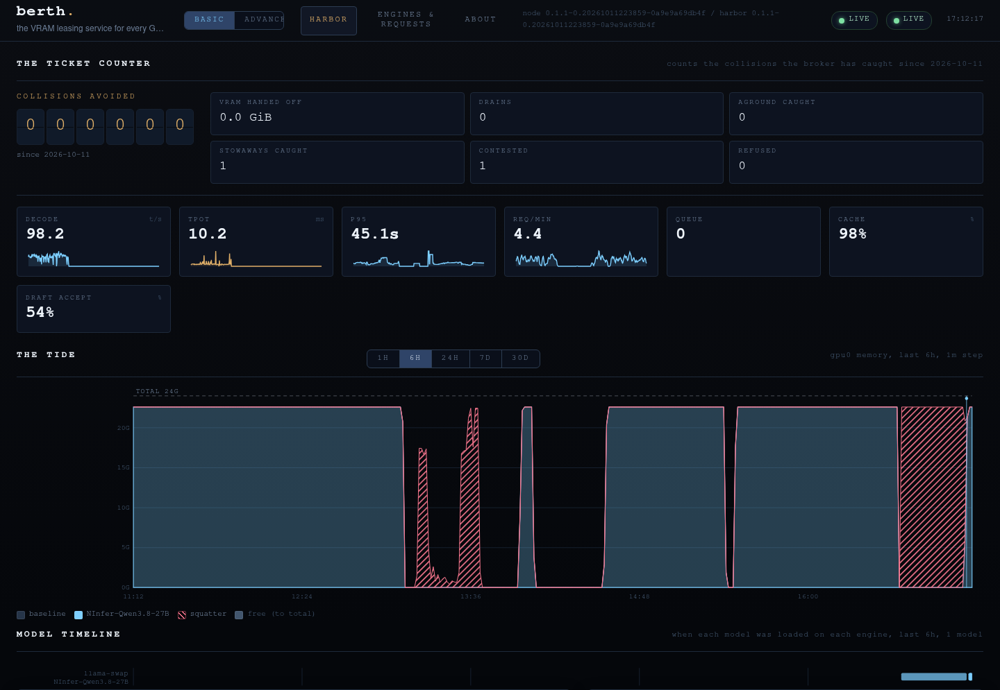
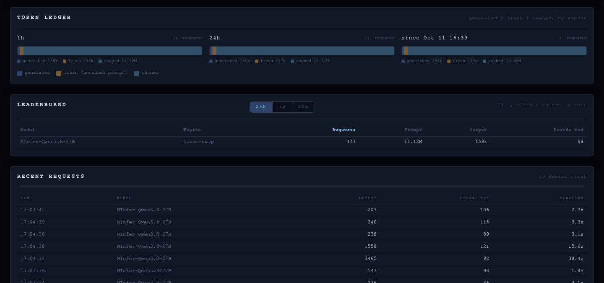

<p align="center"></p>

<p align="center"><b>The VRAM leasing service for every GPU you run.</b><br>Lease. Hand off. Never collide.</p>

# Berth

Run a chat model in llama-swap, an image pipeline in ComfyUI and a game on one GPU, and
sooner or later two of them load at once and one dies with an out-of-memory error.

Berth puts a harbormaster on the card. Your engines lease the GPU instead of grabbing it.
When another engine needs the card, Berth asks the holder to unload (ComfyUI finishes its
current jobs first), waits until the driver reports the memory free, then lets the next one
in. A process holding VRAM without a lease shows up as a stowaway; Berth reports it and
leaves it running.

The same daemon reads every inference engine on the machine (llama.cpp, llama-swap, Ollama,
vLLM, SGLang, ComfyUI, LM Studio and more, found on their default ports without config) and
the harbor web UI shows the card, the leases, the engines, every request and a token ledger
in one place. One Go binary, no cloud account, nothing else to install.

> **Status: alpha (v0.1).** Linux + NVIDIA. Runs daily on an RTX 4090 workstation alongside
> llama-swap, NInfer and Strata. *Capabilities* lists what works and has tests; the *Roadmap*
> lists what does not exist yet.


## Preview

The harbor on an RTX 4090 running NInfer through llama-swap (real data, basic mode). The tide shows
the card's memory by holder over six hours; the hatched stretch is a stowaway Berth reported while
the model ran without a lease after a daemon restart.

<p align="center"></p>

The Engines & Requests tab: the token ledger, the per-model leaderboard and the request log.

<p align="center"></p>

---

## Install

Two ways: hand it to your coding agent, or do it yourself. Both end in the same place: the
daemon running as a user service, your engines wrapped in `berth run`, and the harbor UI on
<http://127.0.0.1:9798/>.

### Option 1: have your agent install it

Paste this into Claude Code, Codex, Cursor, OpenCode or any coding agent that can run shell
commands on the machine with the GPU:

```text
Install Berth (https://github.com/T-Crypt/berth), a VRAM lease broker for NVIDIA GPUs, on this
Linux machine, following its README and contrib/INTEGRATION.md. Steps:

1. Check prerequisites: Linux, an NVIDIA driver with `nvidia-smi` working, systemd user
   services. Stop and tell me if any is missing.
2. Download the latest release binary for this CPU (berth-linux-amd64 or berth-linux-arm64)
   and its SHA256SUMS from https://github.com/T-Crypt/berth/releases/latest, verify the
   checksum, and install it as ~/.local/bin/berth. (If Go 1.27+ is installed you may instead
   run: go install github.com/T-Crypt/berth/cmd/berth@latest.) Run `berth version`.
3. Install contrib/berthd.service and contrib/berth-harbor.service as systemd user units and
   start them. Confirm with `berth status`.
4. Find the inference engines on this machine (llama.cpp, llama-swap, Ollama, vLLM, SGLang,
   ComfyUI, LM Studio, KoboldCpp, TabbyAPI, LocalAI and so on): what runs them (systemd unit,
   llama-swap config, script) and on which port. Show me the list before changing anything.
5. For each engine I approve, wrap its start command in `berth run` as contrib/INTEGRATION.md
   shows (llama-swap: per-model cmd with the unload URL as --drain-post; ComfyUI: contrib/
   comfyui.service with --drain-comfyui; Ollama: a systemd override of `ollama serve`). Ask me
   which engine wins the card (--priority foreground) and which waits (interactive or batch).
   Back up every file before you edit it and tell me how to undo each change.
6. Engines on non-default ports or other machines: add [[engine]] entries or
   [engines] discover_ports / discover_hosts to ~/.config/berth/berth.toml, then run
   `berth config check`.
7. Restart what you changed, then show me `berth status` with each engine leased and read,
   and the harbor at http://127.0.0.1:9798/. Do not expose the harbor beyond loopback unless
   I ask; it has no authentication.
```

The agent asks before it wraps anything, and every change it makes has an undo.

### Option 2: manual

**1. The binary.** Download `berth-linux-amd64` (or `-arm64`) and `SHA256SUMS` from the
[latest release](https://github.com/T-Crypt/berth/releases/latest):

```sh
cd /tmp
curl -fLO https://github.com/T-Crypt/berth/releases/latest/download/berth-linux-amd64
curl -fLO https://github.com/T-Crypt/berth/releases/latest/download/SHA256SUMS
sha256sum --check --ignore-missing SHA256SUMS
install -Dm755 berth-linux-amd64 ~/.local/bin/berth
berth version
```

Or build it: `go install github.com/T-Crypt/berth/cmd/berth@latest` (Go 1.27+, no C toolchain).

**2. The daemon and the UI** (one per machine, systemd user units from `contrib/`):

```sh
mkdir -p ~/.config/systemd/user
cp contrib/berthd.service contrib/berth-harbor.service ~/.config/systemd/user/
systemctl --user daemon-reload
systemctl --user enable --now berthd berth-harbor
berth status            # the card, leases, stowaways, engines found
```

Open <http://127.0.0.1:9798/>. Engines on their default ports appear on their own.

**3. Wrap your engines** so they lease the card instead of grabbing it. The pattern:

```sh
berth run --as <name> --priority <batch|interactive|foreground> -- <the engine's command>
```

Per-engine recipes (llama-swap, llama.cpp, Ollama, ComfyUI, vLLM, SGLang, custom) are in
[contrib/INTEGRATION.md](contrib/INTEGRATION.md).

**4. Optional configuration** in `~/.config/berth/berth.toml`; validate with
`berth config check`:

```toml
[metrics]
listen = "127.0.0.1:9797"      # Prometheus text, loopback only

[engines]
# discover = true              # default: probe the well-known engine ports every minute
# discover_ports = [9123]      # extra ports to probe
# discover_hosts = ["192.168.1.40"]

[[engine]]                     # anything discovery does not find, on any port
name = "llama-swap"
type = "llama-swap"
url  = "http://127.0.0.1:9090"

[alerts]
[alerts.queue]
warn = 4
crit = 10
```

**Uninstall:** `systemctl --user disable --now berthd berth-harbor`, remove the two unit
files and `~/.local/bin/berth`, and take `berth run ... --` off any engine command you
wrapped. History lives in `~/.local/state/berth/`.

---

## Engines

| Engine | Reader (`type`) | Found on its own | What Berth reads |
|---|---|---|---|
| llama.cpp `llama-server` | `llamacpp` | :8080 | tokens, rates, queue, context window, KV slots |
| llama-swap | `llama-swap` | :8080 | every running model's upstream, request log, per-model window |
| Ollama | `ollama` | :11434 | loaded models and their VRAM |
| vLLM | `vllm` | :8000 | models, window; tokens and queue from `/metrics` |
| SGLang | `sglang` | :30000 | models, window; tokens and queue with `--enable-metrics` |
| ComfyUI | `comfyui` | :8188 | jobs running and queued, version; job-boundary handoff |
| LM Studio | `lmstudio` | :1234 | loaded models, context length |
| KoboldCpp | `koboldcpp` | :5001 | model, context length |
| TabbyAPI (ExLlamaV3) | `tabbyapi` | :5000 | models, context length |
| LocalAI | `localai` | :8080 | models, tokens |
| Unsloth Studio | `unsloth` | :8888 | health; models with an API key |
| FreeToken | `freetoken` | :1919 | tokens, queue |
| [NInfer](https://github.com/T-Crypt/ninfer-4090) | `ninfer` | as llama.cpp | as llama.cpp, plus draft acceptance |
| [Strata](https://github.com/T-Crypt/strata) | `strata` | :8080 | model, window, tokens, queue |
| Any OpenAI-compatible server | `openai` | :8080, :8000 | models |
| Anything else | `custom` | never | your health, models, metrics and slots paths |

Every reader takes any URL, so any port and any host works. Engines that need a key name the
environment variable that holds it (`api_key_env`); the key never goes in the file. An
engine's figures are its own claims and are shown apart from what the driver measures.

---

## Capabilities

### Leasing (the core)
- **Explicit leases.** Engines start through `berth run`, which waits for a berth, starts
  the engine in its own process group, and gives the berth back when the engine exits.
- **Priorities.** `foreground` > `interactive` > `batch`. An equal or higher request
  asks the holder to drain; a lower one waits and is refused with a reason naming the
  holder (exit 75), never an out-of-memory crash.
- **Handoff in steps.** A drain tries the engine's own unload first (for llama-swap, its
  unload URL), then SIGTERM to the process group, then SIGKILL, each after a grace period.
- **Measured release.** Berth grants the next engine only after the driver shows the old
  holder's processes gone, since an exited process can still hold memory.
- **Stuck releases are caught.** A released lease whose memory never frees turns
  *aground* and keeps blocking, with a reason naming the process and how much it holds.
- **Process identity is PID plus start time**, so a reused PID never inherits a lease.
- **Whole-card or sized leases.** `--needs-mib N` lets engines that fit share a card.
- **Fail-open, never silent.** If the daemon is down, `berth run` still starts the engine
  but records it as an *unprotected run* that status shows (`--fail-closed` refuses).
- **Survives a daemon restart.** A running engine stays up when berthd restarts or is
  upgraded; `berth run` dials the new daemon and re-attaches by PID plus start time. For
  15 s after a start the daemon grants nothing new while such engines are still due back,
  so nothing is loaded onto a card an engine already holds.
- **ComfyUI at a job boundary.** `--drain-comfyui` waits until ComfyUI's queue is empty
  before stopping it; a job in progress is never cut off.

### Visibility
- **Stowaways:** every process holding VRAM without a lease, with memory, identity and
  first-seen time; optional desktop notification and webhook. Report-only by design.
- **Contested grants:** a grant made while stowaways hold memory is flagged, not hidden.
- **Event log:** every request, wait, drain, release, free, stuck lease, stowaway and
  probe change, with gap-free sequence numbers; `berth events -f` follows it live.
- **The collisions board:** collisions avoided, VRAM handed off, drains, stuck releases
  caught, stowaways caught, contested grants, refusals. Each count links back to a
  recorded event.
- **Alerts:** one threshold table in `berth.toml` (`[alerts]`): warn and crit per key
  (`queue`, `ttft`, `tpot`, `p95`, `cache`, `reingest`, `vram`, `temp`, `power`, `kv`).
  The node evaluates it on its 5 s sample cycle, fires a desktop notification and webhook
  on entering a level, and logs `alert.raised` / `alert.cleared` events (`berth events
  -f`, the harbor log); a level stays until the value stays clear for `clear_polls`
  samples (default 3). GPU probe failure and aground leases are built-in danger alerts,
  always on. Default posture: no `[alerts]` table means no KPI alerts, and the
  notification channels are separately opt-in (`--notify`, `--webhook`). The harbor
  colors the same state the node notifies on: KPI tiles and GPU cells, a strip of the
  currently-breaching keys, and an overall LIVE / DEGRADED / OFFLINE state beside the
  connection pill.

### Telemetry (built in, no other tool needed)
- **GPU:** memory, utilisation, temperature, power against its limit, fan, SM and memory
  clocks, PCIe link, for **every card** in the machine with its real limits.
- **Host:** CPU, RAM, swap, load.
- **Engines:** every engine in the table above, found on its default port or configured on
  any other. Loaded models, decode and prefill tok/s, token totals,
  queue, draft acceptance, the context window per model (llama.cpp/NInfer `/props`, Strata
  `/health`, llama-swap per model proxy), and the live KV slot pool (`/slots`: per-slot
  context tokens against the window). An engine without those endpoints degrades to
  "no window / no slot data", never an error. An engine that was up and stops
  answering is shown as **unresponsive** (latched), distinct from one that never ran.
- **Requests:** a 24-hour request log from llama-swap; requests per minute, p50 and p95
  latency, prefill time, time per output token, cache and re-ingest share, a token ledger
  (1 h, 24 h, since start), a per-model leaderboard, and the most recent requests.
- **History:** the node keeps the last hour at 5-second resolution in memory. The harbor
  stores it on disk (SQLite, no C toolchain needed): 1-minute rows for 30 days, per engine
  the KV pressure (peak slot fill against the window) and the resident models' windows,
  hourly rows for 400 days, and the request log for 30 days, de-duplicated by request id.
  Databases written before the KV column is added are migrated in place on the first
  open; nothing is ever rewritten.
- **Model timeline:** when each model was loaded and unloaded on each engine, kept across
  restarts. A gap in the readings over 3 minutes is never drawn as loaded.
- The UI labels engine-reported figures as the engine's own, apart from what the driver
  measures.

### Interfaces
- **CLI:** `berth status`, `berth events -f`, `berth run`, `berth config check`, `berth export`.
  Berth runs fully headless.
- **Harbor web UI** (`berth harbor`): a departures board of every lease, a boat ticket
  per lease, the collisions counter, berths with measured memory, stowaways, the event
  log, and engine metrics. The tide (card memory by holder) and the model timeline share a
  1H / 6H / 24H / 7D / 30D picker; the Engines tab adds a queue KPI (the berth's own
  queue; each engine's own queue stays on its card), the KV pool (the live slots of each
  engine against their model windows, stored ranges the per-minute peak slot fill), context
  residency (the last requests' token figures against the model's window, plus the live
  KV sessions), a throughput chart, a 24H / 7D / 30D leaderboard and, in advanced mode, a
  storage panel. The top bar shows the overall state (LIVE / DEGRADED / OFFLINE) and a
  strip of the alerts currently breaching, colored from the node's own threshold state.
  Basic and advanced modes.
  Read-only, strict content security policy. It listens on loopback by default
  (`127.0.0.1:9798`); passing a non-loopback `--listen` address (e.g. `0.0.0.0:9798`;
  a specific interface IP works too) is the explicit opt-in to expose it on your
  network: the startup logs a warning and the page shows a banner on every screen while
  exposed. There is no authentication in this release — expose it only on a network you
  trust; phones on that network get the full read-only dashboard. To reach it from elsewhere
  without exposing it, keep the loopback listener and put a same-machine reverse proxy in
  front (`tailscale serve`, caddy), passing the proxy's hostname with `--allow-host`. A systemd user unit is
  in `contrib/berth-harbor.service`.
- **Prometheus** `/metrics` (loopback only) for Grafana and friends.
- **Footprint:** the node uses about 0.2% of one CPU core and ~21 MB of memory on the
  reference box; the harbor about 0.4% and ~23 MB, writing to disk once a minute.

---

## Support matrix

| Platform | Status |
|---|---|
| Linux + NVIDIA | Supported |
| Windows + NVIDIA | Experimental (builds; process-tree attribution and named pipes pending) |
| AMD, Intel, Apple | Not supported yet (the telemetry layer is an interface for later backends) |
| Multiple GPUs | Inventoried with real limits; leases schedule one card per daemon today |

---

## Roadmap

| Phase | What it delivers | Status |
|---|---|---|
| P0 | Safety core: identity, measured release, stuck and contested detection, unprotected runs | **Done** |
| P1 | Node API: event log, collisions board, config, engine readers, `/metrics`, light probe | **Done** |
| P2 | Harbor web UI; native telemetry, request KPIs, ledger, leaderboard, stored history, measured against Speculum parity | **Done** |
| P3 | Actions: drain, `berth hold` / resume (for games and calls), behind authentication | Planned |
| P4 | Restart reconciliation: engines re-attach after a daemon restart, nothing left unprotected | **Done** |
| P5 | Fleet: `berth install --harbor <addr> --join <token>` on every machine; nodes push metrics into the harbor's store (already built for one box in P2) | Planned |
| P6 | ComfyUI job-boundary handoff on Linux (**done**); first Windows node (planned) | Partly done |
| P7 | Offers: a waiting request can offer for an idle card on another machine; the holder decides | Planned |
| P8 | Multi-GPU scheduling: a lease table per card, "any card that fits" | Planned |
| P9 | Organisations: single sign-on, roles, audit log, regional harbors | Planned |
| P10 | Opt-in auto-yield: a card's owner can pre-approve offers for their own card | Later |
| P11 | A staffed harbor: a local model routes leases and offers, seeing only VRAM metadata | Later |

P0, P1, P2 and P4 are done, and ComfyUI on Linux from P6, with a reader for every engine in
the table above.

## What Berth never does

- Kill a process it did not start, or any process by default.
- Grant a card because a process exited, before the driver shows the memory free.
- Claim memory is reserved when it is only estimated to be free.
- Take a card from another user's machine without their consent (on one machine, only the
  priorities you set decide).
- Require a cloud account, telemetry upload, or any other software to work.

## Contributing

Issues and pull requests are welcome. [AGENTS.md](AGENTS.md) has the one command that proves a
change (build, format, vet, tests, lint, as CI runs them) and the invariants a change must
keep.

## License

[Apache License 2.0](LICENSE). The Berth name, the Pilot mascot and the artwork in `assets/`
are not covered by the license; see [NOTICE](NOTICE). Third-party components:
[THIRD_PARTY_NOTICES](THIRD_PARTY_NOTICES).
