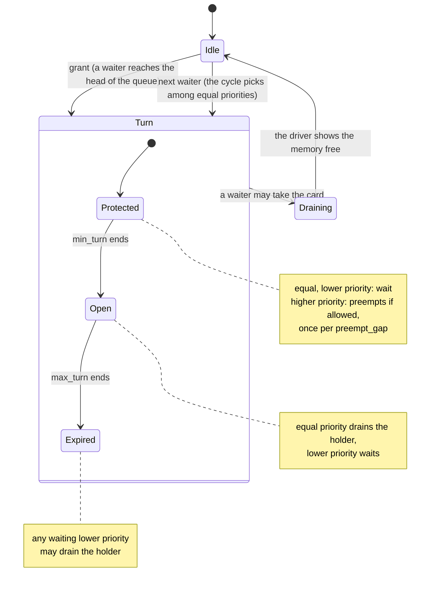
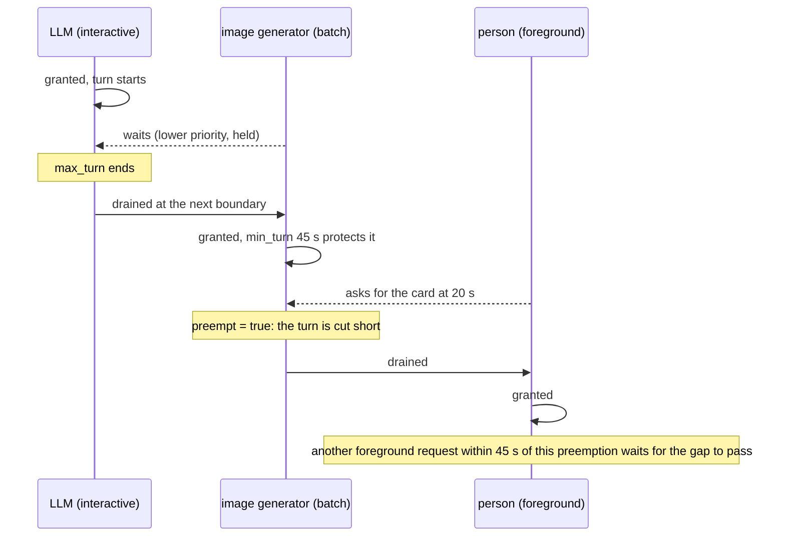

# Leasing, games and holds

## Leasing (the core)
- **Explicit leases.** Engines start through `berth run`, which waits for a berth, starts
  the engine in its own process group, and gives the berth back when the engine exits.
- **Priorities.** `foreground` > `interactive` > `batch`. An equal or higher request
  asks the holder to drain; a lower one waits and is refused with a reason naming the
  holder (exit 75), never an out-of-memory crash.
- **Handoff in steps.** A drain tries the engine's own unload first (for llama-swap, its
  unload URL), then SIGTERM to the process group, then SIGKILL, each after a grace period.
- **Measured release.** Berth grants the next engine only after the driver shows the old
  holder's processes gone, since an exited process can still hold memory.
- **Stuck releases are caught.** A released lease whose memory never frees turns
  *aground* and keeps blocking, with a reason naming the process and how much it holds.
- **A way out for a stuck release.** `berth reclaim [lease]` lists what the stuck lease
  recorded, PID, start time, memory and command, and anything on the card no lease
  recorded ("not Berth's", report only). With `--yes` it stops exactly the recorded
  ones, SIGTERM first and SIGKILL to the survivors after `--grace`, re-checking each
  PID and start time immediately before every signal.
- **Process identity is PID plus start time**, so a reused PID never inherits a lease.
- **Children stay on the lease.** On Linux with a systemd user manager, `berth run`
  gives the engine its own cgroup scope, which every child inherits on fork: a child
  that escapes its process group and reparents keeps the lease stuck under its own
  name instead of turning into a stowaway. Without a user manager, Berth records every
  descendant of the wrapper each tick, which covers everything except a fork whose
  parent exits inside one tick. On Windows, a child keeps its parent's PID after the
  parent exits, so Berth follows each GPU process's parent chain from a process
  snapshot it refreshes every second, and the job object `berth run` puts the engine
  in carries every process it starts, so a drain stops them all.
- **Stop signals.** A SIGTERM, SIGINT or SIGHUP to `berth run` drains the engine and releases the lease. On
  Windows, Ctrl-C, Ctrl-Break, closing the console window and logging off do the same, and the engine's drain
  has to finish in the few seconds Windows allows after a close. `berth gateway` starts each run in its own
  process group on Windows, so Ctrl-C in the gateway's console does not drain engines it meant to leave running.
- **Whole-card or sized leases.** `--needs-mib N` lets engines that fit share a card.
- **Several cards.** One berthd governs every card by default. A foreground request on one card never drains a
  holder on another. `berth run --gpu gpu1` puts a lease on one card, and `--gpu gpu0,gpu1` holds one lease on
  both (see [Training runs](#training-runs)). A running game holds every card, because Berth cannot tell which
  card it will use. A lease on several cards cannot park or lend yet.
- **Fail-open, never silent.** If the daemon is down, `berth run` still starts the engine
  but records it as an *unprotected run* that status shows (`--fail-closed` refuses).
- **Survives a daemon restart.** A running engine stays up when berthd restarts or is
  upgraded; `berth run` dials the new daemon and re-attaches by PID plus start time. For
  15 s after a start the daemon grants nothing new while such engines are still due back,
  so nothing is loaded onto a card an engine already holds.
- **ComfyUI at a job boundary.** `--drain-comfyui` waits until ComfyUI's queue is empty
  before stopping it; a job in progress is never cut off.
- **No juggling.** Two engines at the same priority drain each other: the last one asked for
  wins, which is what you want when you switch models. When two clients want different
  engines at once, that flips the card back and forth and every request fails. Berth calls it
  a juggle when an engine is drained within `juggle_window` (15 s) of getting the card while it
  is still busy (a request in flight, a ComfyUI job queued, a model loading). The engine ranking
  decides a juggle: the winner keeps or takes the card, and the loser waits for it instead of
  draining it back. An idle holder hands over at once, so chat, then an image, then chat again
  is three clean handoffs. A person's switch (Launch on the gateway's wake page, or
  `/v1/berth/switch`) is never a juggle: it takes the card whatever the ranking says, and inside
  the window a request no person made (a chat client's background call) does not take it back.
  A switch to an engine whose start a request already queued, and lost a juggle, reaches that
  start's lease and takes the card too. To keep it longer, give the engine a `min_turn`.

  ```toml
  [priority]
  order = ["llama-swap", "strata", "comfyui"]  # first is best; omit to rank by use
  juggle_window = "15s"                        # a negative value turns it off
  ```

  Without an `order`, the engine with the most hours on the card through Berth over the last
  7 days ranks first (kept in `~/.local/state/berth/usage.json`); a tie leaves the holder in
  place. `berth run --group NAME` files a lease under an engine family: llama-swap runs each
  model under its own name, so give each `--group llama-swap`. `berth status` shows the ranking
  and a count of juggles stopped; the harbor log shows each one with the reason.

  - **A minimum turn per engine.** `min_turn = "5m"` on the engine entry (or
    `berth run --min-turn 5m`) gives the engine a turn it keeps for that long after the
    grant: in that time a request of equal or lower priority cannot drain it, and neither can
    a higher one, because a request interrupted halfway is a lost one. Only a hold (a game, a
    call, `berth hold`) takes the card out before the turn ends.

    ```toml
    [[engine]]
    name  = "comfyui"
    min_turn = "5m"   # the card stays this engine's for 5m after the grant
    ```

    A blocked waiter is told how much of the turn is left ("next in line: comfyui has its
    minimum turn, 3m12s left"), and `berth status` shows the time a lease has left in the
    TURN column. When the turn ends the normal rules apply: a drain still starts at the slot
    or job boundary, and a minimum turn never cuts a request off. After a daemon restart, a
    re-attach starts a fresh turn.

## Round-robin turns

Two engines that share a card, say an LLM server and an image generator, each want it for a while and
neither should starve the other. Berth already hands the card over at the request boundary and keeps a
`min_turn`. The `[turns]` table adds three opt-in rules on top; with none of them set, nothing above changes.
None of them cuts a request off: a drain still starts at the slot or job boundary, a pinned lease or a hold is
never drained by them, and the driver must still show the memory free before the next grant.

```toml
[turns]
max_turn    = "15m"                    # the longest a holder keeps the card against a lower priority
cycle       = ["llm", "image"]         # who is served next among equal priorities
preempt     = true                     # a higher priority may cut a min_turn short...
preempt_gap = "45s"                    # ...at most once per this long (default 45s)

[turns.max_turn_by]                    # per engine (its name, or --group), over max_turn
image = "30m"
```

- **Maximum turn.** Priorities keep a lower-priority waiter out for as long as the holder runs. With
  `max_turn`, a holder that has had the card that long stops outranking a waiting lower priority: the waiter
  drains it at the next boundary. `0` (the default) is no limit.
- **Rotation.** Waiters of one priority are normally served by arrival. With `cycle`, the engine after the
  last one granted goes first, so `llm`, `image`, `llm`, `image` alternate even when `llm` asks more often.
  Engines not listed go after the listed ones, by arrival.
- **Preemption.** A `min_turn` keeps every waiter out, however urgent. With `preempt = true` a waiter of a
  strictly higher priority (a person at the keyboard, say) may drain a holder inside its `min_turn`. Each such
  cut makes the engine it empties reload from cold, so Berth allows one per `preempt_gap`; a second waiter
  inside the gap is told when the next preemption is allowed. A waiter of equal or lower priority still waits
  out the turn.



The timeline of one card with two engines, `min_turn = 45s` and `preempt_gap = 45s`:



`berth config show` prints the settings that are on. A wait reason names what the waiter is waiting for:
"has its minimum turn, 3m12s left", or "a turn was preempted 10s ago; the next preemption is allowed in 35s".

## Games, apps and holds
- **Claims cover work Berth does not start.** berthd scans the process table every 2 s.
  A *hold* claim keeps the card while its process runs: engines are drained and wait, with a
  15 s linger so a launcher restarting the game does not bounce the card back. A *track*
  claim names an app's card memory so it counts against the card without being reported as a
  stowaway; nothing waits on it.
- **Built-in pack, on by default.** Holds: Steam games (anything under Steam's `reaper`),
  Lutris and gamescope on Linux; Steam libraries (`steamapps\common`), Epic, GOG, EA,
  Ubisoft, Xbox and Battle.net games on Windows, with launchers, Wallpaper Engine and
  Lossless Scaling left out. Tracks: Blender, DaVinci Resolve, OBS, Kdenlive, Premiere,
  After Effects. `berth claims` shows every rule and what it matches now.
- **Your own rules:**

  ```toml
  [[claim]]
  name = "training"
  cmdline = 'train\.py'      # regex; on Windows it sees the exe's full path
  action = "hold"            # or "track"
  linger = "30s"

  [claims]
  builtin = false            # turn the built-in pack off
  ```

  A rule can also match `exe` names (globs, `.exe` optional), a launcher `parent` (with
  `parent_cmdline`, a regex that launcher's own command line must match too), and exclude with
  `not_cmdline`. The built-in Steam rule matches Steam's `reaper` only when it runs as
  `reaper SteamLaunch AppId=...`, so the REAPER DAW, also named `reaper`, holds nothing.
- **`berth hold [--for 2h] [--reason game]`** takes the card for you. It is a pinned lease at
  the top priority, so nothing drains it, and it ends on Ctrl-C, after `--for`, or when the
  process dies.
- **`berth run --pinned`** gives an app a lease that is never drained (it keeps the card until
  it exits).
- A hold cannot free memory held by something outside Berth: that memory is still reported,
  as contested.

## Training runs

A training run that loses its cards loses everything since its last checkpoint. Run it under one pinned lease:

```sh
berth run --as train-mymodel --pinned --priority foreground --gpu gpu0,gpu1,gpu2 \
  -- torchrun --nproc_per_node 3 train.py
```

- `--pinned` keeps every card of the lease. A foreground run, a game's hold, `berth hold` and another lease on
  several cards all wait until the run exits. A gateway request never drains it, and the gateway's stop answers
  `409`. `berth stop train-mymodel` still stops it, because a person asked.
- `--priority` decides only how the run gets its cards. `foreground` drains interactive and batch engines so the
  run can start. A hold or a pinned app already on a card makes it wait.
- berthd grants the cards together and starts the command with `CUDA_VISIBLE_DEVICES` set to their UUIDs, in the
  order you named them. Do not set `CUDA_VISIBLE_DEVICES` yourself, since Berth leaves it alone when it is set. Set
  `--nproc_per_node` to the number of cards.
- Leave `--needs-mib` at 0, the whole card. Training memory grows after the first steps.
- The workers torchrun or `accelerate launch` starts belong to the lease, so their memory is the run's on every card.
- A berthd restart or upgrade does not stop the run. It keeps running, and berthd re-attaches it with its pin on
  every card.

A pin does not stop memory taken outside Berth. A game started on a leased card waits behind the run in Berth but
still allocates memory, and that can run the training out of memory. Keep the card that drives your display out of
`--gpu`. A crash or a power cut needs checkpoints. With Hugging Face's `Trainer`, set `save_steps` and resume with
`trainer.train(resume_from_checkpoint=True)`.
